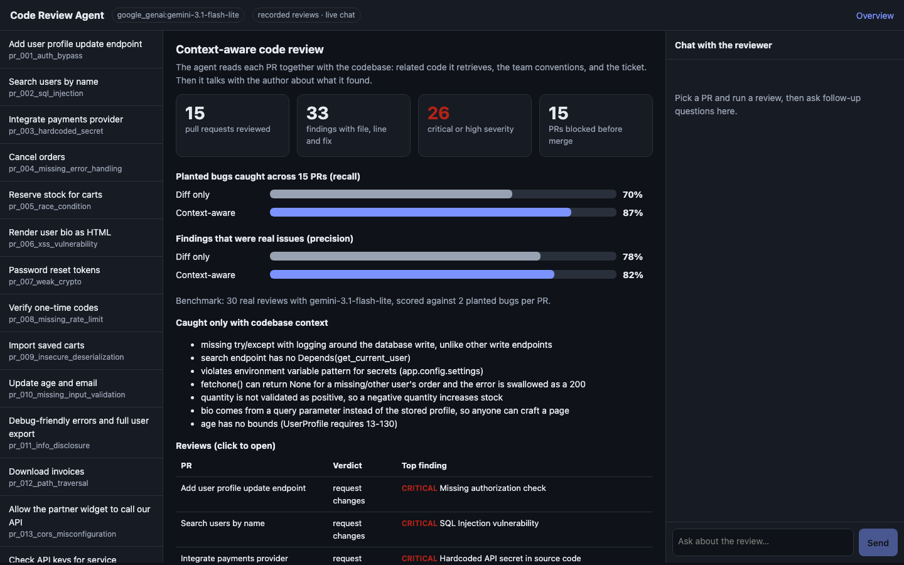
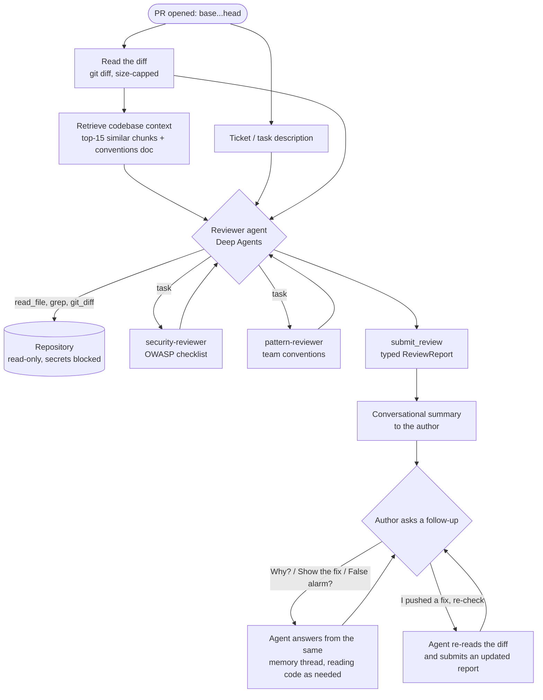
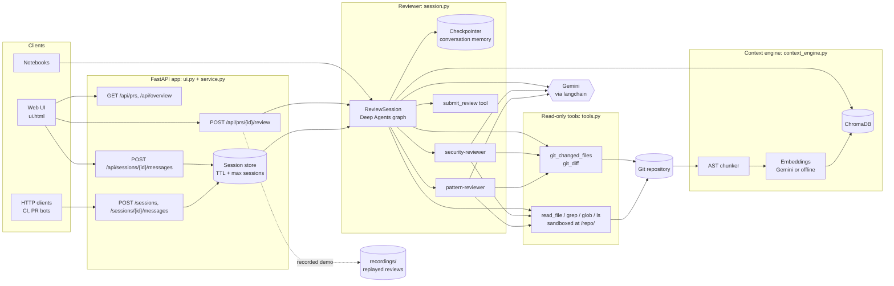
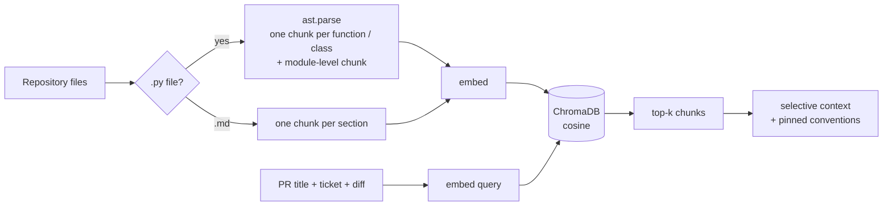

# AI Code Review Agent

A conversational, context-aware code review agent built on [LangChain Deep Agents](https://github.com/langchain-ai/deepagents) and Gemini.

The agent reviews a pull request the way a senior teammate who knows the codebase would. It reads the diff together with the ticket, the team's conventions and the related code it retrieves from the repository. It can open files and re-read the diff itself through read-only tools, and it hands focused passes to a security specialist and a pattern-compliance specialist. It returns typed findings, each with a severity, file, line and concrete fix. Then it **talks with the author**: why an issue matters, what the fixed code looks like, whether something might be a false alarm, and whether a new commit resolves it. In a benchmark of 30 real reviews across 15 mock PRs, adding codebase context raised the share of planted bugs caught from **70% to 87%**, and precision from 78% to 82%.



---

## Contents

1. [Quick start](#quick-start)
2. [How a review flows](#how-a-review-flows)
3. [Architecture](#architecture)
4. [Components in detail](#components-in-detail)
5. [Sample inputs and outputs](#sample-inputs-and-outputs)
6. [Benchmark](#benchmark)
7. [HTTP API](#http-api)
8. [Configuration](#configuration)
9. [Safety and production defaults](#safety-and-production-defaults)
10. [Project layout](#project-layout)
11. [Extending it](#extending-it)

---

## Quick start

```bash
git clone https://github.com/RCPRP/AI_Code_Review.git
cd AI_Code_Review
git checkout feature/code-review-agent
cp .env.example .env              # add GOOGLE_API_KEY (Gemini)
uv sync                           # or: pip install -r requirements.txt
uv run uvicorn review_agent.ui:app --port 8765
```

Open **http://localhost:8765**:

1. The **Overview** shows the benchmark and a table of all 15 reviewed PRs.
2. Click any PR to see its diff, then click **Run context-aware review**.
3. Ask follow-up questions in the chat panel. The suggested questions replay recorded answers, and anything you type is answered live.

Other entry points:

```bash
uv run pytest                                         # guardrail and API tests, no model calls
uv run jupyter lab code_review_agent.ipynb            # walkthrough notebook (Lessons 4 to 6 + production agent)
uv run python -m review_agent.recordings              # re-record the 15 demo reviews (real model calls)
uv run python -m review_agent.recordings --benchmark  # re-run the diff-only vs context-aware benchmark
```

---

## How a review flows

What happens from the moment someone opens a pull request to the moment they get answers:



The same steps in words:

1. **Diff.** The agent reads `base...head` through a git tool that validates refs, times out, and caps the output size.
2. **Retrieval.** The context engine searches an index of the repository's functions, classes and docs using the PR title, ticket and diff. It returns the most relevant chunks and always includes the conventions doc.
3. **Review.** The Deep Agents reviewer gets the diff, the ticket and the retrieved code in its first message. It decides whether to open more files, grep for patterns, or delegate to its two specialists. Each specialist runs in its own context window.
4. **Structured output.** The agent calls `submit_review` with a `ReviewReport`: a verdict, a summary and a list of findings. The tool call is the contract, so the agent can still write naturally to the author.
5. **Conversation.** Every turn uses the same checkpointed thread. Follow-ups such as "show me the fix" or "I pushed a change, re-check" happen with full memory of the review. A re-check calls `git_diff` again and submits an updated report.

---

## Architecture



### Layers

| Layer | Responsibility | Files |
|---|---|---|
| **Interface** | Web UI, HTTP API, notebooks | `ui.py`, `ui.html`, `service.py`, `*.ipynb` |
| **Agent** | Conversational review, delegation, memory, structured output | `session.py`, `prompts.py` |
| **Context** | Chunking, embedding and retrieval of related code and conventions | `context_engine.py` |
| **Tools** | Read-only, validated access to git and files | `tools.py` |
| **Evaluation** | Mock PRs, scoring, benchmark, recordings | `sample_prs.py`, `toy_repository.py`, `evaluation.py`, `reviewer.py`, `recordings.py` |
| **Config** | Env-driven settings, model selection, logging | `config.py`, `schema.py` |

---

## Components in detail

### Reviewer agent: `review_agent/session.py`

`ReviewSession` wraps one `create_deep_agent(...)` graph:

| Piece | What it is |
|---|---|
| **Model** | `init_chat_model(REVIEW_MODEL)`, Gemini by default, with timeouts and retries |
| **Tools** | `git_changed_files`, `git_diff`, `submit_review`, plus Deep Agents' built-in `read_file`, `grep`, `glob` and `ls` over a sandboxed backend |
| **Subagents** | `security-reviewer` (OWASP checklist) and `pattern-reviewer` (team conventions), each with the same read-only tools |
| **Backend** | `CompositeBackend`: the repo is mounted read-only at `/repo/`, and scratch notes live in agent state |
| **Permissions** | Writes to `/repo/**` are denied. Reads of `.env*`, `*.pem`, `*.key`, `id_rsa*` and `.git/**` are denied. |
| **Memory** | A LangGraph checkpointer keyed by `session_id`, so every turn shares the thread |
| **Output** | `submit_review(args_schema=ReviewReport)`. The session parses the tool call into a typed report. |

```python
session = ReviewSession(repo, base="main", head="feature",
                        task_context="Users can update their own profile.",
                        retriever=retriever)
session.start()                    # -> {"reply": "...", "tool_calls": [...], ...}
session.report                     # -> ReviewReport(verdict=..., findings=[...])
session.ask("Show me the fixed code")
```

### Context engine: `review_agent/context_engine.py`



- **Chunking:** Python files are split with `ast`, so each function or class (including its decorators) is one chunk. Imports and constants form a module chunk. Markdown is split by heading. `.env` files are never indexed.
- **Embeddings:** Gemini `gemini-embedding-001` when a Google key is set. Otherwise an offline hashed bag-of-identifiers embedding that needs no key and no download, and is good at "which code shares names with this diff".
- **Retrieval:** `retrieve_for_pr(pr, n_results=15)` returns about 6k characters instead of the whole repo's 11k, and always pins the conventions doc.

### Specialist ensemble: `review_agent/reviewer.py`

This is used for the Lesson-6 style benchmark. Two specialists review the same context in parallel, and `merge_findings` combines their results:

1. It keeps findings both specialists agree on: same file, and nearby lines or overlapping titles.
2. It adds unique critical, high and medium findings from either specialist.
3. It drops unique low and nit findings and deduplicates.

### Typed output: `review_agent/schema.py`

```python
class Finding(BaseModel):
    severity: Literal["critical", "high", "medium", "low", "nit"]
    category: Literal["correctness", "security", "tests", "performance", "maintainability", "style"]
    file: str
    line: int | None
    title: str
    explanation: str
    suggestion: str
    confidence: float  # 0..1

class ReviewReport(BaseModel):
    verdict: Literal["approve", "comment", "request_changes"]
    summary: str
    findings: list[Finding]
```

### Demo UI: `review_agent/ui.py` + `ui.html`

A single page with no build step:

- a **PR list**
- the **diff** with added and removed lines coloured
- **findings cards** sorted by severity, each with an "Ask about this" button
- a **chat panel** with suggested questions
- an **Overview** with totals and the benchmark

Each answer in the chat shows a trail of what the agent did, for example "read the diff · read 3 files · consulted 2 specialists".

`REVIEW_MODE=auto` (the default) opens a PR's recorded review instantly when one exists, and answers any question the recording doesn't cover live with the model. This keeps a demo working on a free-tier key.

### Evaluation: `review_agent/evaluation.py`, `sample_prs.py`, `toy_repository.py`

- The **toy repository** is a FastAPI service with 14 written conventions in `docs/CONVENTIONS.md`, for example: auth via `Depends(get_current_user)`, secrets from settings, `FOR UPDATE` on inventory, `safe_join` for paths.
- There are **15 mock PRs**. Each is materialised as a real git repo (`main` plus `feature`) with 2 planted issues. Several issues are invisible without context.
- **Scoring is deterministic.** A finding matches an expected issue when it names the same file and contains one of that issue's keywords at a word boundary. Matching is one-to-one, then precision, recall and F1 are computed.

---

## Sample inputs and outputs

These three examples come from real recorded runs in `recordings/`, using `gemini-3.1-flash-lite`. The code is shortened for readability.

### Example 1: Missing authentication and error handling (`pr_001_auth_bypass`)

**Input**

Ticket: *"Users can update their own profile (name, email, age)."*

```diff
+@router.put("/api/users/{user_id}")
+def update_user(user_id: int, profile: UserProfile):
+    with get_db() as db:
+        db.execute("UPDATE users SET name = ?, email = ?, age = ? WHERE id = ?",
+                   (profile.name, profile.email, profile.age, user_id))
+    return {"status": "success"}
```

**Output: review** (verdict `request_changes`)

| Severity | Where | Finding | Fix |
|---|---|---|---|
| critical | `app/routes/users.py:36` | Missing authorization check | Add `current_user: User = Depends(get_current_user)` and verify `current_user.id == user_id` or `current_user.is_admin` |
| high | `app/routes/users.py:37` | Missing error handling for database write | Wrap the update in `try/except`, log with `logger.exception`, raise `HTTPException(500)` |

> *"The most important issues are the lack of authorization (any user can currently update anyone else's profile) and the missing error handling for the database update… the need to add `get_current_user` dependency and wrap the database operation in a `try/except` block to follow our established conventions."*

**Output: follow-up**, *"Show me the fixed code"*

```python
@router.put("/api/users/{user_id}")
def update_user(user_id: int, profile: UserProfile, current_user: User = Depends(get_current_user)):
    if current_user.id != user_id and not current_user.is_admin:
        raise HTTPException(status_code=403, detail="Forbidden")
    try:
        with get_db() as db:
            db.execute("UPDATE users SET name = ?, email = ?, age = ? WHERE id = ?",
                       (profile.name, profile.email, profile.age, user_id))
    except Exception:
        logger.exception("update_user failed for %s", user_id)
        raise HTTPException(status_code=500, detail="Could not update user")
    return {"status": "success"}
```

**Why context mattered:** in the benchmark, the diff-only reviewer caught the auth issue but missed the error-handling one. That issue is only a problem because every other write endpoint in the codebase uses the try/except + `logger.exception` pattern.

### Example 2: Race condition in inventory (`pr_005_race_condition`)

**Input**

Ticket: *"Reserve stock when an item is added to a cart."*

```diff
+@router.post("/api/cart/reserve")
+def reserve(product_id: int, quantity: int, current_user: User = Depends(get_current_user)):
+    try:
+        with get_db() as db:
+            stock = db.execute("SELECT stock FROM inventory WHERE product_id = ?", (product_id,)).fetchone()[0]
+            if stock >= quantity:
+                db.execute("UPDATE inventory SET stock = ? WHERE product_id = ?", (stock - quantity, product_id))
+    except Exception:
+        logger.exception("reserve failed")
+        raise HTTPException(status_code=500, detail="Could not reserve")
+    return {"status": "reserved"}
```

**Output: review** (verdict `request_changes`)

| Severity | Where | Finding | Fix |
|---|---|---|---|
| critical | `app/routes/orders.py:40` | Race condition in inventory reservation | Use `SELECT ... FOR UPDATE` for the initial stock read |
| medium | `app/routes/orders.py:37` | Missing input validation for quantity | `if quantity <= 0: raise HTTPException(...)` |
| medium | `app/routes/orders.py:40` | Unhandled case for non-existent product | Check the row exists before `[0]`; return 404 |
| medium | `app/routes/orders.py:42` | Missing feedback for insufficient stock | Raise `HTTPException(409, "Insufficient stock")` |

> *"The current implementation has a race condition that could lead to inventory overselling. It needs to use the same `FOR UPDATE` locking strategy that you correctly implemented in `create_order`."*

**Output: follow-up**, *"Show me the fixed code"* (excerpt)

```python
if quantity <= 0:
    raise HTTPException(status_code=400, detail="quantity must be positive")
try:
    with get_db() as db:
        row = db.execute("SELECT stock FROM inventory WHERE product_id = ? FOR UPDATE",
                         (product_id,)).fetchone()
        if row is None:
            raise HTTPException(status_code=404, detail="Product not found")
        ...
```

**Why context mattered:** the agent pointed to the existing `create_order` as the model to follow. Diff-only review caught the race but missed the negative-quantity bug, which context-aware review caught by comparing against `create_order`'s validation.

### Example 3: Path traversal on invoice download (`pr_012_path_traversal`)

**Input**

Ticket: *"Users download their invoice PDFs by file name."*

```diff
+import os
+
+@router.get("/api/invoices/{name}")
+def invoice(name: str):
+    return FileResponse(os.path.join(settings.UPLOAD_DIR, "invoices", name))
```

**Output: review** (verdict `request_changes`)

| Severity | Where | Finding | Fix |
|---|---|---|---|
| critical | `app/routes/files.py:22` | Potential path traversal vulnerability | Use the `safe_join` helper already imported in the file |
| high | `app/routes/files.py:20` | Missing authentication/authorization | Add `current_user: User = Depends(get_current_user)` |

> *"It doesn't check if the user is authenticated (violating our convention that all data endpoints require `get_current_user`), and it uses `os.path.join` directly on user input, which opens us up to path traversal attacks."*

**Output: follow-up**, *"Show me the fixed code"*

```python
@router.get("/api/invoices/{name}")
def invoice(name: str, current_user: User = Depends(get_current_user)):
    invoices_dir = os.path.join(settings.UPLOAD_DIR, "invoices")
    return FileResponse(safe_join(invoices_dir, name))
```

**A live follow-up** typed in the UI, *"Could this leak other customers' invoices? Explain for a non-engineer."*, is answered by the model on the spot, using the diff, retrieved code and the review.

---

## Benchmark

30 real reviews with `gemini-3.1-flash-lite`, 15 PRs × 2 approaches, 2 planted issues per PR. Results are in `recordings/_benchmark.json`.

| Approach | Context given | Recall | Precision | F1 | Avg context |
|---|---|---|---|---|---|
| Diff only | the diff | 70% | 78% | 74% | 0 chars |
| Context-aware | diff + ticket + retrieved code + conventions | **87%** | **82%** | **85%** | ~5.9k chars |

Issues caught **only** with context included:
- missing try/except with logging around a database write
- a search endpoint without `Depends(get_current_user)`
- a secret not loaded from `app.config.settings`
- `fetchone()` returning `None` swallowed as a 200
- a negative quantity increasing stock
- a bio rendered from a query parameter
- an age field with no 13 to 130 bounds

The notebook also compares full-repo context, the specialist ensemble and the full agentic reviewer.

---

## HTTP API

`review_agent/service.py`, served alongside the UI:

| Method | Path | Body | Returns |
|---|---|---|---|
| `GET` | `/healthz` | | `{ok, model, sessions}` |
| `POST` | `/sessions` | `{repo_path, base, head, title, task_context}` | `{session_id, reply, report, report_updated}` |
| `POST` | `/sessions/{id}/messages` | `{message}` | `{session_id, reply, report, report_updated}` |
| `GET` | `/sessions/{id}` | | `{report, turns}` |

UI endpoints: `GET /api/prs`, `GET /api/prs/{id}`, `POST /api/prs/{id}/review`, `POST /api/sessions/{id}/messages`, `GET /api/overview`, `GET /api/config`.

```bash
curl -s -X POST localhost:8765/sessions -H 'Content-Type: application/json' \
  -d '{"repo_path": "'$PWD'/.eval_repos/pr_012_path_traversal", "base": "main", "head": "feature",
       "task_context": "Users download their invoice PDFs by file name."}'
```

---

## Configuration

All settings come from environment variables or `.env`; see `.env.example`.

| Variable | Default | Purpose |
|---|---|---|
| `GOOGLE_API_KEY` | | Gemini LLM and embeddings (preferred) |
| `GOOGLE_CLOUD_PROJECT`, `GOOGLE_CLOUD_LOCATION` | `us-central1` | Gemini via Vertex AI with gcloud credentials instead of a key |
| `ANTHROPIC_API_KEY`, `OPENAI_API_KEY` | | Fallback LLM providers |
| `REVIEW_MODEL` | `google_genai:gemini-3.1-flash-lite` | Any `init_chat_model` string, e.g. `google_genai:gemini-3.8-flash` |
| `REVIEW_MODE` | `auto` | UI: `auto` (recorded reviews + live chat), `live`, `replay` |
| `REVIEW_EMBEDDINGS` | `gemini` with a Google key, else `local` | `gemini`, `local` (offline) or `chroma` |
| `REVIEW_RETRIEVAL_K` | `15` | Chunks retrieved per PR |
| `REVIEW_MODEL_TIMEOUT_S` / `REVIEW_MODEL_MAX_RETRIES` | `120` / `3` | Model call limits |
| `REVIEW_MAX_DIFF_CHARS` / `REVIEW_MAX_FILE_MB` | `60000` / `1` | Input size caps |
| `REVIEW_RECURSION_LIMIT` | `60` | Max agent loop steps |
| `REVIEW_ALLOWED_ROOTS` | current folder | Repos the HTTP API may review |
| `REVIEW_MAX_SESSIONS` / `REVIEW_SESSION_TTL_S` | `100` / `3600` | Session store limits |
| `LANGSMITH_API_KEY`, `LANGSMITH_TRACING`, `LANGSMITH_PROJECT` | | Optional tracing. Runs are tagged `code-review` with mode and model metadata. |

---

## Safety and production defaults

- **Least privilege:** the agent never writes to the repo. Secret files (`.env*`, keys, certificates) and `.git/` internals are unreadable, and `virtual_mode` stops paths escaping the repo root.
- **Validated git access:** refs must match `^(?!-)[A-Za-z0-9._/~^-]{1,100}$`, so `--output=...` style option injection is rejected. Paths with `..` are rejected. Git runs without a shell, with a timeout and an output cap.
- **Bounded cost:** model timeouts and retries, diff and file size caps, and a recursion limit.
- **API hardening:** a repo path allowlist, request size limits, session TTL and caps, one in-flight message per session, and generic error messages to clients with details in the logs.
- **No secrets in code:** all keys come from `.env`, which is git-ignored.
- **Tests:** `tests/test_guardrails.py` covers option injection, path traversal, chunking, matching, merge rules, the API allowlist and UI replay, all without model calls.

---

## Project layout

```
.
├── review_agent/
│   ├── config.py           # env-driven settings, model choice, logging
│   ├── schema.py           # Finding, ReviewReport
│   ├── tools.py            # read-only git tools, sandboxed backend, permissions
│   ├── context_engine.py   # AST chunking, embeddings, ChromaDB retriever
│   ├── prompts.py          # general, security, pattern and conversational prompts
│   ├── reviewer.py         # single-pass review + specialist ensemble
│   ├── session.py          # ReviewSession: the conversational Deep Agents reviewer
│   ├── evaluation.py       # matching, precision/recall/F1, parallel eval runner
│   ├── toy_repository.py   # FastAPI demo service with team conventions
│   ├── sample_prs.py       # 15 mock PRs, materialised as git repos
│   ├── recordings.py       # record/replay demo sessions, benchmark
│   ├── service.py          # HTTP API
│   ├── ui.py               # web UI routes
│   └── ui.html             # single-page UI
├── recordings/             # 15 recorded reviews + _benchmark.json
├── tests/                  # guardrail and API tests (no model calls)
├── docs/overview.png
├── code_review_agent.ipynb             # walkthrough notebook
├── code_review_agent_standalone.ipynb  # self-contained version
├── pyproject.toml / requirements.txt
└── .env.example
```

---

## Extending it

- **Review your own repo:** `ReviewSession(Path("~/my/project").expanduser(), base="main", head="my-branch", task_context="...")`, or `POST /sessions` with `repo_path` under `REVIEW_ALLOWED_ROOTS`. Build the retriever from your repo's files with `build_retriever({path: text, ...})`.
- **CI bot:** call `POST /sessions` on each PR, post `report.findings` as inline comments, and fail the check on `request_changes`.
- **Durable memory:** swap `InMemorySaver` for a SQLite or Postgres checkpointer so sessions survive restarts.
- **Grow the eval set:** add every real miss or false alarm to `sample_prs.py` and re-run the benchmark.
- **Write actions:** if you add tools that post comments or open fix PRs, gate them with Deep Agents' `interrupt_on` for human approval.
